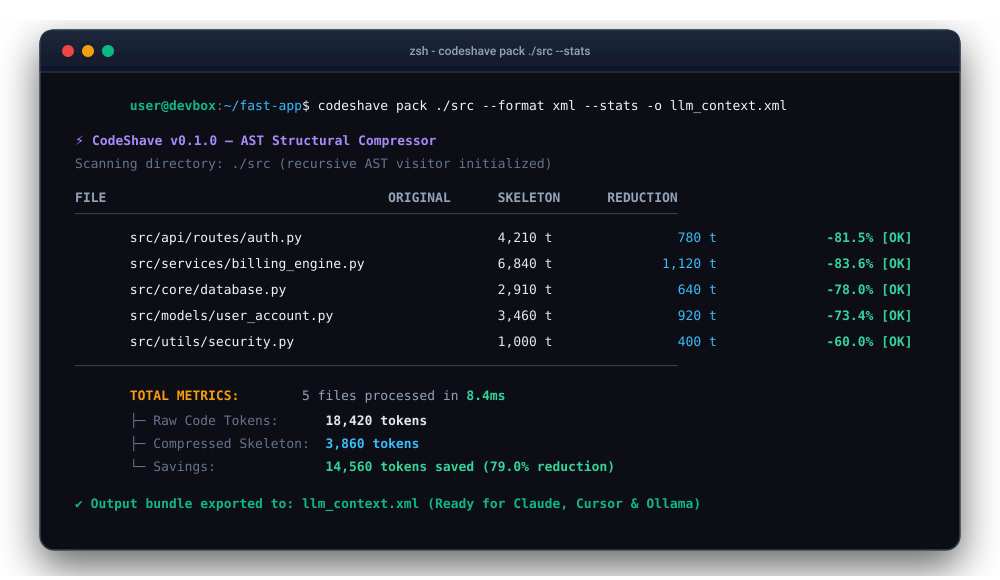

# CodeShave

<p align="center">
  
</p>

<p align="center">
  <a href="https://pypi.org/project/codeshave/"></a>
  <a href="https://pypi.org/project/codeshave/"></a>
  <a href="https://github.com/jaideepkrishna2008-ui/codeshave/actions/workflows/ci.yml"></a>
  <a href="https://buymeacoffee.com/jaideep.360"></a>
</p>

<p align="center">
  <b>High-speed, deterministic AST code context compressor for AI coding assistants and local LLMs.</b><br>
  Reduces prompt tokens by 60% to 80% while preserving valid syntax, type signatures, and class hierarchies.
</p>

---

## ⚡ Terminal Demo

<p align="center">
  
</p>

<p align="center">
  <a href="https://jaideepkrishna2008-ui.github.io/codeshave/" target="_blank">
    
  </a>
</p>

---

## 🎯 Why CodeShave?

When developers feed large directories to LLMs or AI agents, context windows quickly fill up, latency spikes, and API token bills mount. 

Traditional approaches either:
1. Truncate files blindly, breaking syntax trees and references.
2. Rely on costly, slow LLMs to summarize code before prompting.

**CodeShave** uses Python's native Abstract Syntax Tree (AST) engine to deterministically transform code into clean interface skeletons:
- Strips implementation logic inside functions and replaces with `...`.
- Preserves all class structures, inheritance, and attributes.
- Retains parameter type annotations, defaults, and return types.
- Maintains decorators, docstrings, and module-level exports.
- Formats context blocks into Markdown, Claude-optimized XML, or JSON.

---

## 🏗️ Architecture

<p align="center">
  
</p>

---

## 🚀 Quickstart

### Installation

Install globally via PyPI:

```bash
pip install codeshave
```

Or install from GitHub:

```bash
pip install git+https://github.com/jaideepkrishna2008-ui/codeshave.git
```

### ⚡ CLI Commands

```bash
# 📋 One-Click Clipboard Copy: Compress and copy directly to clipboard
codeshave clip ./src
codeshave clip ./src/models.py
# -> Copied to clipboard! Ready to paste directly into ChatGPT, Claude, or Cursor!

# 📦 Pack directory into an LLM context bundle
codeshave pack ./src -o llm_context.md

# 🏷️ Generate Claude-optimized XML bundle with live savings statistics
codeshave pack ./src --format xml --stats -o llm_context.xml

# 🔍 Inspect a single file's compressed skeleton
codeshave inspect ./src/services/billing.py
```

---

## 🔌 AI Assistant & Editor Integration (MCP Server)

CodeShave runs as a turnkey **Model Context Protocol (MCP)** server over standard I/O (`stdio`). This allows AI coding assistants to automatically invoke CodeShave and compress source code before analyzing it, saving up to 80% on prompt tokens.

### 1. Claude Desktop

Add to your `claude_desktop_config.json`:
* **macOS**: `~/Library/Application Support/Claude/claude_desktop_config.json`
* **Windows**: `%APPDATA%\Claude\claude_desktop_config.json`

```json
{
  "mcpServers": {
    "codeshave": {
      "command": "codeshave",
      "args": ["mcp"]
    }
  }
}
```

### 2. Cursor IDE

1. Open **Cursor Settings** $\rightarrow$ **Features** $\rightarrow$ **MCP**.
2. Click **+ Add New MCP Server**.
3. Configure:
   * **Name**: `codeshave`
   * **Type**: `command`
   * **Command**: `codeshave mcp`

Alternatively, add to `.cursor/mcp.json` in your workspace:

```json
{
  "mcpServers": {
    "codeshave": {
      "command": "codeshave",
      "args": ["mcp"]
    }
  }
}
```

### 3. Windsurf Editor

Add to `~/.codeium/windsurf/mcp_config.json`:

```json
{
  "mcpServers": {
    "codeshave": {
      "command": "codeshave",
      "args": ["mcp"]
    }
  }
}
```

### 4. Google Antigravity

In your Antigravity MCP configuration (`~/.gemini/antigravity/mcp_config.json` or project settings):

```json
{
  "mcpServers": {
    "codeshave": {
      "command": "codeshave",
      "args": ["mcp"]
    }
  }
}
```

### 5. OpenAI / Codex & Autonomous Agents

Invoke CodeShave directly inside your custom agentic pipelines via Python SDK:

```python
from codeshave import compress_source, compute_savings

with open("complex_service.py") as f:
    code = f.read()

# Shave 80% of tokens while retaining 100% valid Python interface syntax
skeleton = compress_source(code, preserve_docstrings=True)
report = compute_savings(code, skeleton)

prompt = f"Analyze this architecture:\n\n{skeleton}"
# Send compressed prompt to OpenAI, Claude, or local Ollama
```

### Python API

```python
from codeshave import compress_source, compute_savings

raw_code = open("service.py").read()
skeleton = compress_source(raw_code, preserve_docstrings=True)
report = compute_savings(raw_code, skeleton)

print(skeleton)
print(report.summary_line())
```

---

## 📊 Token Savings Benchmark

| Source Type | Original Tokens | CodeShave Skeleton | Reduction | Syntax Status |
| :--- | :--- | :--- | :--- | :--- |
| Data Models | 3,460 t | 920 t | **73.4%** | ✅ Valid AST |
| API Endpoints | 4,210 t | 780 t | **81.5%** | ✅ Valid AST |
| Business Logic | 6,840 t | 1,120 t | **83.6%** | ✅ Valid AST |
| Utility Scripts | 1,000 t | 400 t | **60.0%** | ✅ Valid AST |

---

## 💖 Sponsorship & Backing

If CodeShave saves you tokens, reduces your API bills, or accelerates your agent workflow, consider supporting ongoing open-source development:

<p align="left">
  <a href="https://buymeacoffee.com/jaideep.360" target="_blank">
    
  </a>
  &nbsp;&nbsp;
  <a href="https://github.com/sponsors/jaideepkrishna2008-ui" target="_blank">
    
  </a>
</p>

* **Buy Me A Coffee**: [https://buymeacoffee.com/jaideep.360](https://buymeacoffee.com/jaideep.360)
* **GitHub Sponsors**: [https://github.com/sponsors/jaideepkrishna2008-ui](https://github.com/sponsors/jaideepkrishna2008-ui)

---

## 📄 License

Created by **Jaideep Krishna A** ([@jaideepkrishna2008-ui](https://github.com/jaideepkrishna2008-ui)).
Licensed under the Apache License 2.0 or MIT equivalent open-source terms.
