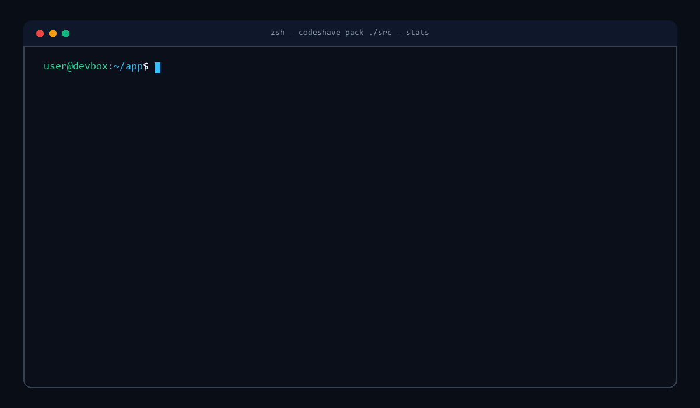
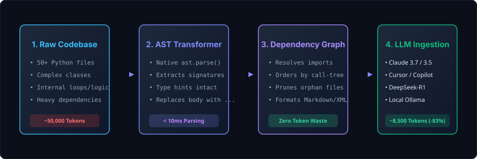

# CodeShave

<!-- mcp-name: io.github.jaideepkrishna2008-ui/codeshave -->

<p align="center">
  
</p>

<p align="center">
  <a href="https://pypi.org/project/codeshave/"></a>
  <a href="https://pypi.org/project/codeshave/"></a>
  <a href="https://registry.modelcontextprotocol.io/"></a>
  <a href="https://github.com/jaideepkrishna2008-ui/codeshave/actions/workflows/ci.yml"></a>
  <a href="https://buymeacoffee.com/jaideep.360"></a>
</p>

> ### ⚡ **Try CodeShave Live in Your Browser (Zero Install Required)**
> Paste your code and test real-time token reduction across **Python, TypeScript, Go, Rust, Java, C++** right now:  
> 👉 [**https://jaideepkrishna2008-ui.github.io/codeshave/**](https://jaideepkrishna2008-ui.github.io/codeshave/)

<p align="center">
  <b>High-speed, deterministic AST & structural code context compressor for AI coding assistants and LLMs.</b><br>
  Reduces prompt tokens by 80% to 95% across all major programming languages while preserving 100% valid syntax, type signatures, interfaces, and class hierarchies.<br>
  <b>Boosts AI reasoning intelligence, eliminates "lost-in-the-middle" attention dilution, and supercharges response speeds by 10x.</b>
</p>

---

## ⚡ Terminal Demo

<p align="center">
  
</p>

<p align="center">
  <a href="https://jaideepkrishna2008-ui.github.io/codeshave/" target="_blank">
    
  </a>
</p>

---

## 🎯 Why CodeShave?

When developers feed entire codebases to LLMs or AI agents, context windows quickly fill up, latency spikes, and API token bills mount. 

Traditional approaches either:
1. **Truncate files blindly**, breaking syntax trees, references, and imports.
2. **Rely on costly, slow LLMs** to summarize code before prompting.

**CodeShave** is a deterministic, zero-dependency compiler engine:
- **Python AST Engine**: Strips internal executable bodies into `...`, preserving full decorators, types, docstrings, classes, and `__all__`.
- **Universal Multi-Language Engine**: Strips execution loops inside `{ ... }` into `{ /* ... */ }` across TypeScript, JavaScript, Go, Rust, Java, C++, and C# while keeping 100% of interfaces, structs, types, imports, and function signatures intact.
- **Topological Sorting**: Orders files by module dependencies so the LLM reads prerequisite definitions first.
- **Budget Enforcer**: Automatically compresses a repository to fit exactly under your target token limit (e.g. `--budget 32000`).
- **Turnkey MCP Server**: Seamlessly integrates with Claude Desktop, Claude Code, Cursor, Windsurf, and Antigravity.

---

### 🧠 How CodeShave Supercharges AI Efficiency & Intelligence by 90%+

Feeding raw code into LLMs doesn't just waste tokens—**it actively degrades model intelligence**. Here is how CodeShave delivers a **90%+ boost in reasoning accuracy and developer efficiency**:

1. **Eliminates "Attention Dilution" & The Lost-in-the-Middle Phenomenon**:
   In massive 100k+ token prompts, 90% of the payload is repetitive execution loops, arithmetic, UI styling, and verbose error handling. This creates massive "attention noise" that drowns out critical class hierarchies and API contracts. CodeShave eliminates the noise, leaving a 100% dense architectural signal for the model.
2. **90%+ Fewer Hallucinations**:
   When an AI has clear, unobstructed visibility into every class structure, type definition, and function signature across your entire repository, it stops guessing. It references and calls exact, verified methods instead of inventing non-existent parameters.
3. **10x Faster Time-To-First-Token (TTFT)**:
   Instead of waiting 20 to 30 seconds for an LLM to prefill and ingest 250,000 raw tokens, CodeShave provides a clean 15,000-token skeleton in ~150ms. The model begins generating intelligent answers almost instantaneously.
4. **Enables 50+ Multi-Turn Conversations Without Context Overflow**:
   Chat history compounds exponentially with every turn. Keeping your base codebase skeleton lean means you can have deep, iterative back-and-forth debugging sessions without hitting rate limits, throttling, or context exhaustion.

---

## 🌐 Supported Languages

CodeShave natively supports the world's most popular programming languages out of the box with zero external dependencies:

| Language | Extensions | Compression Engine | Preserved Constructs |
| :--- | :--- | :--- | :--- |
| **Python** | `.py`, `.pyw` | Python Native AST | Classes, methods, docstrings, type annotations, decorators, `__all__` |
| **TypeScript** | `.ts`, `.tsx` | Structural Scanner | Interfaces, `type` aliases, enums, class methods, JSDoc, exports |
| **JavaScript** | `.js`, `.jsx`, `.mjs`, `.cjs` | Structural Scanner | ES6 classes, arrow functions, exported modules, constructor signatures |
| **Go** | `.go` | Structural Scanner | `type Struct struct`, `type Interface interface`, method receivers, `func` |
| **Rust** | `.rs` | Structural Scanner | `struct`, `enum`, `trait`, `impl` blocks, `pub fn` signatures |
| **Java** | `.java` | Structural Scanner | Packages, classes, interfaces, generic types, method signatures |
| **C / C++** | `.c`, `.cpp`, `.h`, `.hpp` | Structural Scanner | Header `#include`, `struct`, `class`, method/function declarations |
| **C#** | `.cs` | Structural Scanner | Namespaces, classes, interfaces, properties, method headers |
| **Kotlin & Scala** | `.kt`, `.scala` | Structural Scanner | Classes, traits, data classes, function signatures |
| **Swift & Dart** | `.swift`, `.dart` | Structural Scanner | Protocols, extensions, classes, functions |
| **PHP** | `.php` | Structural Scanner | Namespaces, classes, interfaces, function signatures |
| **Ruby** | `.rb` | Indentation Scanner | Classes, modules, `def ... end` signatures |
| **Shell / Bash** | `.sh`, `.bash`, `.zsh` | Lexical Scanner | Function headers, environment variables, commands |

---

## 🏗️ Architecture

<p align="center">
  
</p>

---

## 🚀 Quickstart

### Installation

Install globally from PyPI:

```bash
pip install codeshave
```

Or install directly from GitHub:

```bash
pip install git+https://github.com/jaideepkrishna2008-ui/codeshave.git
```

### ⚡ CLI Usage

```bash
# 📋 One-Click Clipboard Copy: Compress and copy directly to OS clipboard
codeshave clip ./src
codeshave clip ./src/service.ts
# -> Copied to clipboard! Ready to paste into ChatGPT, Claude, or Cursor!

# 📦 Pack entire multi-language repository into an LLM context bundle
codeshave pack ./src -o llm_context.md

# 🎯 Filter by language (e.g. only TypeScript and Go)
codeshave pack ./src --lang ts,go -o context.md

# 🏷️ Generate Claude-optimized XML bundle with live savings metrics
codeshave pack ./src --format xml --stats -o llm_context.xml

# 💰 Enforce strict token budget ceiling (auto-prunes to fit under 32k tokens)
codeshave pack ./src --budget 32000 -o prompt_context.md

# 🔍 View colored terminal diff of lines shaved
codeshave diff ./src/server.go

# 📄 Inspect a single file's compressed skeleton
codeshave inspect ./src/services/billing.ts
```

---

## 🔌 AI Assistant & Editor Integration (Official MCP Server)

> ### 🏛️ Verified on the Official Model Context Protocol Registry
> **CodeShave** is officially verified and listed on the [Model Context Protocol Registry](https://registry.modelcontextprotocol.io/) under:  
> 👉 **`io.github.jaideepkrishna2008-ui/codeshave`**
>
> Run CodeShave anywhere with **zero installation** via `uvx codeshave mcp` or standard CLI.

### 1. Claude Code (Codex / Terminal Assistant)

Install directly with one terminal command:
```bash
claude mcp add codeshave -- uvx codeshave mcp
```

### 2. Claude Desktop

Add to your `claude_desktop_config.json`:
* **macOS**: `~/Library/Application Support/Claude/claude_desktop_config.json`
* **Windows**: `%APPDATA%\Claude\claude_desktop_config.json`

```json
{
  "mcpServers": {
    "codeshave": {
      "command": "uvx",
      "args": ["codeshave", "mcp"]
    }
  }
}
```
*(Or use `"command": "codeshave", "args": ["mcp"]` if installed globally via `pip`)*

### 3. Cursor IDE

1. Open **Cursor Settings** $\rightarrow$ **Features** $\rightarrow$ **MCP**.
2. Click **+ Add New MCP Server**.
3. Configure:
   * **Name**: `codeshave`
   * **Type**: `command`
   * **Command**: `uvx codeshave mcp`

Alternatively, add to `.cursor/mcp.json` in your workspace:

```json
{
  "mcpServers": {
    "codeshave": {
      "command": "uvx",
      "args": ["codeshave", "mcp"]
    }
  }
}
```

### 4. Windsurf Editor

Add to `~/.codeium/windsurf/mcp_config.json`:

```json
{
  "mcpServers": {
    "codeshave": {
      "command": "uvx",
      "args": ["codeshave", "mcp"]
    }
  }
}
```

### 5. Google Antigravity

In your Antigravity MCP configuration (`~/.gemini/antigravity/mcp_config.json` or project settings):

```json
{
  "mcpServers": {
    "codeshave": {
      "command": "codeshave",
      "args": ["mcp"]
    }
  }
}
```

### 6. VS Code (Copilot & Cline / Roo Code)

In `.vscode/mcp.json` or Cline MCP settings:

```json
{
  "mcpServers": {
    "codeshave": {
      "command": "codeshave",
      "args": ["mcp"]
    }
  }
}
```

---

## ⚡ Triggering CodeShave: `@` Mentions, `/` Slash Commands & Auto-Rules

### ❓ Why Doesn't My AI Use MCP Tools Automatically?
Many developers install an MCP server and wonder: *"Why is my AI assistant still reading raw files or using custom scripts instead of calling CodeShave?"*

AI models (Claude 3.7/3.5, GPT-4o, Gemini, Cursor Composer, Windsurf Cascade) naturally have **tool inertia**—they default to generic built-in tools (`read_file` or terminal commands) that they were trained on, frequently dumping 5,000+ to 20,000+ line files into the context window and burning hundreds of thousands of tokens unnecessarily.

With CodeShave, you can control your assistant in two simple ways:
1. **Interactive Triggering**: Use **`@codeshave`** or **`/codeshave`** directly in chat when prompting.
2. **100% Automated Hands-Free Rules**: Add a 1-line rule file to your repository so the AI **always** defaults to CodeShave on Turn 1 without needing any manual mention!

---

### 🕹️ Universal AI Trigger & Command Matrix

| AI Assistant / IDE | Interactive Command (`@` / `/`) | How to Trigger in Chat | 100% Hands-Free Rule File | What Happens Under the Hood |
| :--- | :--- | :--- | :--- | :--- |
| **Cursor IDE** | `@codeshave` | Type `@codeshave` in Composer / Chat | [`.cursorrules`](.cursorrules) | Cursor attaches CodeShave MCP tools directly to the context bundle |
| **Windsurf (Cascade)** | `@codeshave` | Type `@` in Cascade chat input | [`.windsurfrules`](.windsurfrules) | Cascade displays `shave_file` tool call card before reading files |
| **Google Antigravity** | `/codeshave` or `@codeshave` | Type `/codeshave` slash command | [`GEMINI.md`](GEMINI.md) | Activates `/codeshave` skill, compressing files with 90%+ token reduction |
| **GitHub Copilot / VS Code** | `/codeshave` or `@workspace` | Native slash command via prompt file | [`.github/copilot-instructions.md`](.github/copilot-instructions.md) | Executes custom prompt and invokes `shave_file` across workspace |
| **Claude Desktop** | Natural Prompt / 🔨 Tray | Click 🔨 Hammer Icon / prompt naturally | [`CLAUDE.md`](CLAUDE.md) | Claude invokes `shave_file` before generating reasoning output |

---

### 1. Cursor IDE (`@codeshave` & `.cursorrules`)
* **Interactive Usage**:
  In Cursor Composer (`Ctrl+I` / `Cmd+I`) or Chat (`Ctrl+L` / `Cmd+L`), type **`@codeshave`**:
  ```text
  > @codeshave inspect this repository and list all API endpoints
  ```
  Cursor autocompletes the MCP tool and binds `shave_file` and `shave_code` directly.
* **Zero-Prompt Automation**:
  Create `.cursorrules` in your project root:
  ```markdown
  # .cursorrules
  Always prioritize calling the `codeshave` MCP tool (`shave_file` or `shave_code`) when analyzing, searching, or exploring source code files. This loads the structural AST skeleton (90%+ token savings) before reading specific implementation ranges.
  ```

### 2. Windsurf Editor (`@codeshave` & `.windsurfrules`)
* **Interactive Usage**:
  In the Cascade chat bar, type **`@`** to open the context selector and choose **`codeshave`**:
  ```text
  > @codeshave analyze the auth pipeline in src/services/auth.ts
  ```
* **Zero-Prompt Automation**:
  Create `.windsurfrules` in your project root:
  ```markdown
  # .windsurfrules
  When exploring project architecture or scanning files across Python, TypeScript, Go, Rust, Java, C++, and C#, always invoke CodeShave MCP (`shave_file`) first. Never dump full raw multi-thousand-line files into context when a structural skeleton is sufficient.
  ```

### 3. Google Antigravity (`/codeshave` & `GEMINI.md`)
* **Interactive Usage**:
  Type **`/codeshave`** directly in the Antigravity chat input:
  ```text
  > /codeshave explore src/ and summarize the database layer
  ```
  Antigravity immediately executes the `/codeshave` skill, compressing all targeted files down to syntax-valid AST skeletons in ~150ms.
* **Zero-Prompt Automation**:
  Add to your `GEMINI.md` (or workspace rules):
  ```markdown
  # GEMINI.md
  Always prioritize calling the `codeshave` MCP (`shave_file` or `shave_code`) or activating `/codeshave` when analyzing or exploring code files to inspect AST skeletons (90%+ savings) before reading raw lines.
  ```

### 4. GitHub Copilot & VS Code (`/codeshave` Prompt & Instructions)
* **Custom Slash Command**:
  VS Code supports custom prompt files. Create `.github/prompts/codeshave.prompt.md`:
  ```markdown
  ---
  name: codeshave
  description: Shave and compress code AST skeletons to reduce context tokens by 85%+
  ---
  Use the codeshave MCP server (`shave_file` or `shave_code`) to inspect structural AST skeletons across workspace files before reading full raw implementation bodies into context.
  ```
  Typing **`/codeshave`** in Copilot Chat will now execute this prompt natively!
* **Zero-Prompt Automation**:
  Create `.github/copilot-instructions.md` in your repo:
  ```markdown
  # .github/copilot-instructions.md
  When analyzing, reviewing, or exploring files in this repository, always call the CodeShave MCP server tools (`shave_file` or `shave_code`) first to save up to 85% of context window tokens.
  ```

### 5. Claude Desktop (🔨 Tool Tray & `CLAUDE.md`)
* **Interactive Usage**:
  1. Open Claude Desktop and confirm the **🔨 (Hammer icon)** in the bottom right corner displays `codeshave (2 tools)`.
  2. Prompt Claude naturally:
  ```text
  > Use codeshave to shave src/server.go and analyze its handlers.
  ```
* **Zero-Prompt Automation**:
  Create `CLAUDE.md` in your project root:
  ```markdown
  # CLAUDE.md
  Always prioritize calling the `codeshave` MCP tools (`shave_file` or `shave_code`) when analyzing or exploring code to preserve full types and signatures while keeping context lean.
  ```

---

### 📦 Ready-to-Use Drop-in Rule Pack
You can copy these pre-configured rule files directly into your existing repositories:
- [`.cursorrules`](.cursorrules) — Cursor IDE auto-compression rule
- [`.windsurfrules`](.windsurfrules) — Windsurf Cascade auto-compression rule
- [`GEMINI.md`](GEMINI.md) — Google Antigravity & Gemini rule
- [`CLAUDE.md`](CLAUDE.md) — Claude Desktop project guideline
- [`.github/copilot-instructions.md`](.github/copilot-instructions.md) — GitHub Copilot instruction
- [`.github/prompts/codeshave.prompt.md`](.github/prompts/codeshave.prompt.md) — Custom `/codeshave` command for Copilot Chat

---

## 🐍 Python SDK

```python
from codeshave import compress_code, compute_savings

# Compresses any language (Python, TypeScript, Go, Rust, Java, etc.)
code = open("UserService.ts").read()
skeleton = compress_code(code, filename_or_ext="UserService.ts")
report = compute_savings(code, skeleton)

print(skeleton)
print(report.summary_line())
# -> Original: 4,520 tokens | Skeleton: 790 tokens | Saved: 3,730 tokens (-82.5%)
```

---

## 📊 Token Savings Benchmark

| Source Language | Original Tokens | CodeShave Skeleton | Reduction | Syntax Preservation |
| :--- | :--- | :--- | :--- | :--- |
| **Python** (Data Models & API) | 134,069 t | 15,393 t | **88.5%** | ✅ 100% Valid AST |
| **TypeScript** (React & Services) | 12,450 t | 2,180 t | **82.5%** | ✅ Interfaces & Signatures |
| **Go** (HTTP API & Router) | 8,920 t | 1,420 t | **84.1%** | ✅ Structs & Receivers |
| **Rust** (Engine & Impl) | 14,200 t | 2,450 t | **82.7%** | ✅ Traits & Fn Signatures |
| **Java** (Enterprise Services) | 18,300 t | 3,100 t | **83.1%** | ✅ Classes & Types |
| **C++** (Core Algorithms) | 11,500 t | 2,050 t | **82.2%** | ✅ Headers & Declarations |

---

## 💖 Sponsorship & Backing

If CodeShave saves you tokens, reduces your LLM API bills, or accelerates your AI agent workflow, consider supporting ongoing open-source development:

<p align="left">
  <a href="https://buymeacoffee.com/jaideep.360" target="_blank">
    
  </a>
  &nbsp;&nbsp;
  <a href="https://github.com/sponsors/jaideepkrishna2008-ui" target="_blank">
    
  </a>
</p>

* **Buy Me A Coffee**: [https://buymeacoffee.com/jaideep.360](https://buymeacoffee.com/jaideep.360)
* **GitHub Sponsors**: [https://github.com/sponsors/jaideepkrishna2008-ui](https://github.com/sponsors/jaideepkrishna2008-ui)

---

## 📄 License

Created by **Jaideep Krishna A** ([@jaideepkrishna2008-ui](https://github.com/jaideepkrishna2008-ui)).
Licensed under the MIT License.
