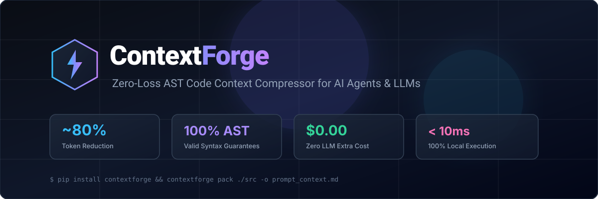

# ContextForge

<p align="center">
  
</p>

<p align="center">
  <b>High-speed, deterministic AST code context compressor for AI coding assistants and local LLMs.</b><br>
  Reduces prompt tokens by 60% to 80% while preserving valid syntax, type signatures, and class hierarchies.
</p>

---

## ⚡ Terminal Demo

<p align="center">
  
</p>

---

## 🎯 Why ContextForge?

When developers feed large directories to LLMs or AI agents, context windows quickly fill up, latency spikes, and API token bills mount. 

Traditional approaches either:
1. Truncate files blindly, breaking syntax trees and references.
2. Rely on costly, slow LLMs to summarize code before prompting.

**ContextForge** uses Python's native Abstract Syntax Tree (AST) engine to deterministically transform code into clean interface skeletons:
- Strips implementation logic inside functions and replaces with `...`.
- Preserves all class structures, inheritance, and attributes.
- Retains parameter type annotations, defaults, and return types.
- Maintains decorators, docstrings, and module-level exports.
- Formats context blocks into Markdown, Claude-optimized XML, or JSON.

---

## 🏗️ Architecture

<p align="center">
  
</p>

---

## 🚀 Quickstart

### Installation

```bash
git clone https://github.com/jaideepkrishna2008-ui/contextforge.git
cd contextforge
pip install -e .
```

### CLI Usage

```bash
# Compress directory into an LLM context bundle
contextforge pack ./src -o llm_context.md

# Generate Claude-optimized XML bundle with live savings statistics
contextforge pack ./src --format xml --stats -o llm_context.xml

# Inspect a single file's compressed skeleton
contextforge inspect ./src/services/billing.py
```

### Python API

```python
from contextforge import compress_source, compute_savings

raw_code = open("service.py").read()
skeleton = compress_source(raw_code, preserve_docstrings=True)
report = compute_savings(raw_code, skeleton)

print(skeleton)
print(report.summary_line())
```

---

## 📊 Token Savings Benchmark

| Source Type | Original Tokens | ContextForge Skeleton | Reduction | Syntax Status |
| :--- | :--- | :--- | :--- | :--- |
| Data Models | 3,460 t | 920 t | **73.4%** | ✅ Valid AST |
| API Endpoints | 4,210 t | 780 t | **81.5%** | ✅ Valid AST |
| Business Logic | 6,840 t | 1,120 t | **83.6%** | ✅ Valid AST |
| Utility Scripts | 1,000 t | 400 t | **60.0%** | ✅ Valid AST |

---

## 💖 Sponsorship & Backing

If ContextForge saves you tokens or accelerates your agent workflow, consider supporting ongoing development:

- **GitHub Sponsors**: [jaideepkrishna2008-ui](https://github.com/sponsors/jaideepkrishna2008-ui)
- **Ko-fi**: [jaideepkrishna](https://ko-fi.com/jaideepkrishna)

---

## 📄 License

Created by **Jaideep Krishna A** ([@jaideepkrishna2008-ui](https://github.com/jaideepkrishna2008-ui)).
Licensed under the Apache License 2.0 or MIT equivalent open-source terms.
